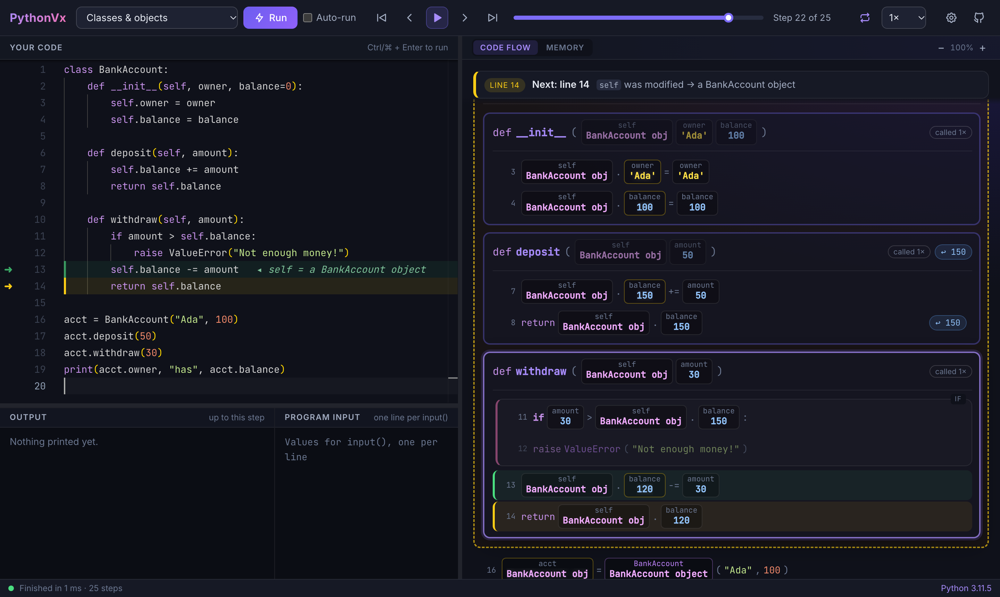
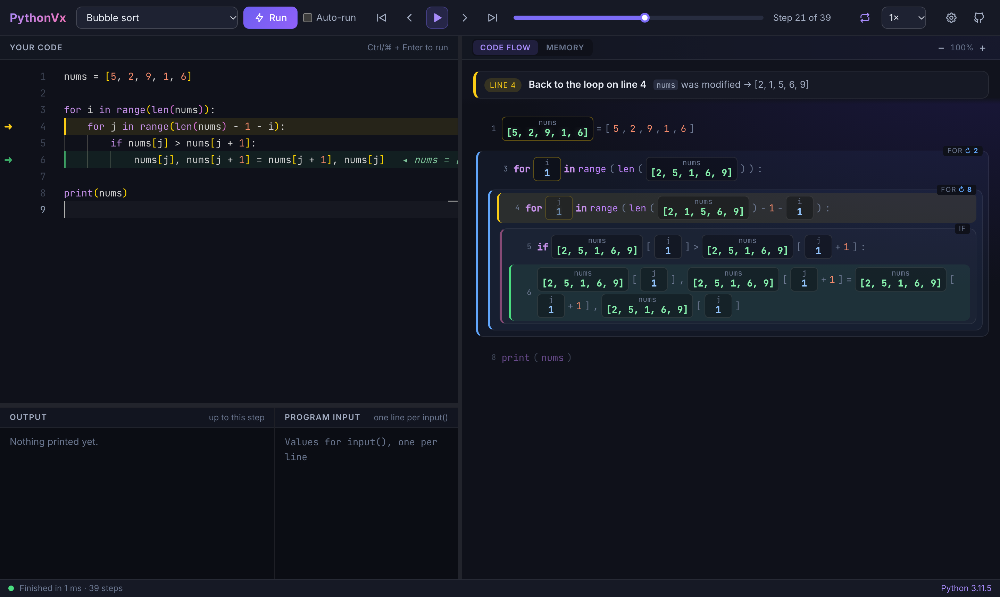
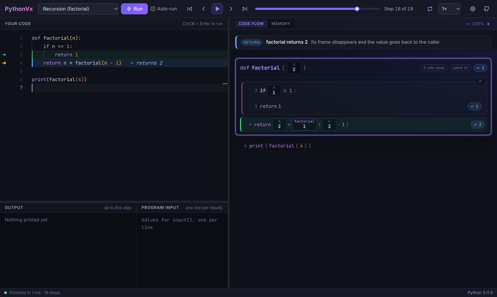
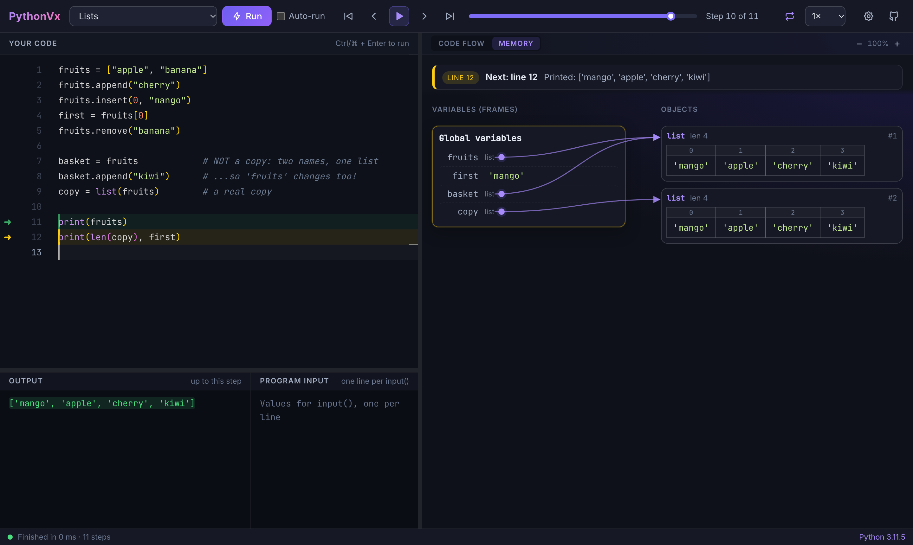
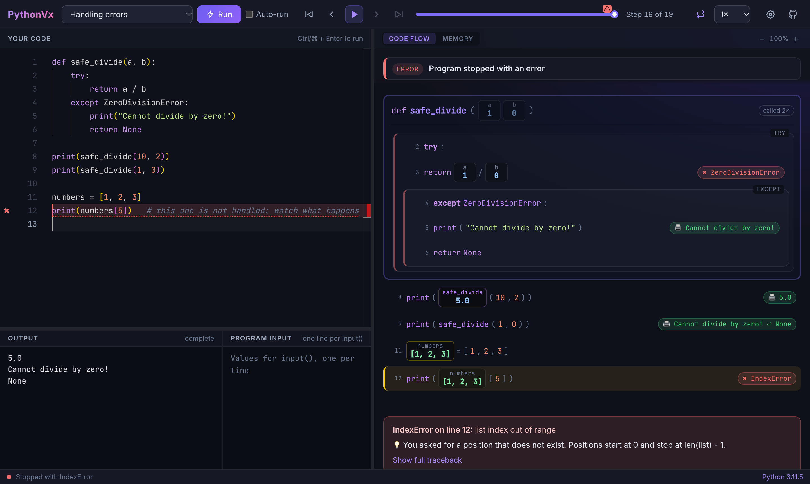
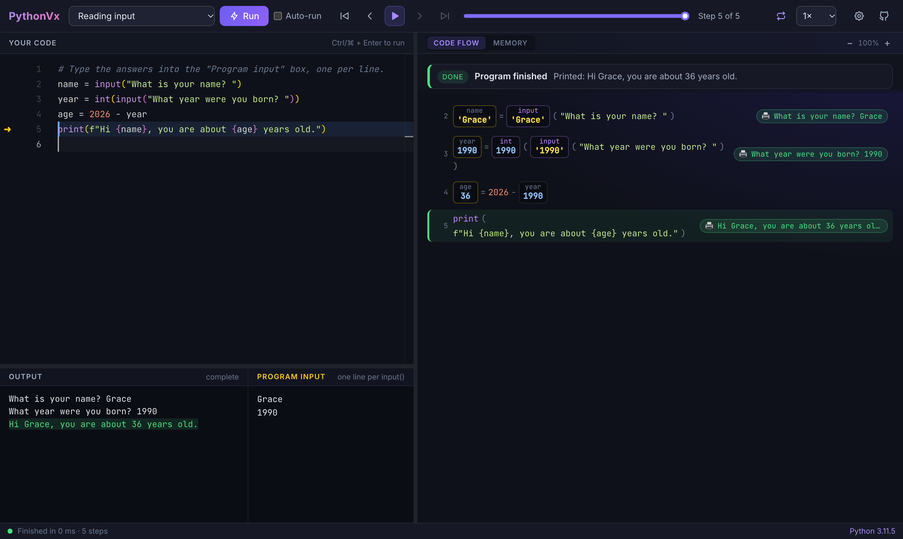

# PythonVx

**See your Python code run, one step at a time.**



PythonVx is a desktop app for people who are learning Python — or who have never programmed before. As you type, the right-hand panel redraws your program as a **block diagram**: every line becomes a block, every variable gets a little box showing its value, and the highlight **flows through the blocks line by line**, exactly the way Python runs your code. Playback keeps looping until you press pause.

- **Code-flow diagram** — functions are drawn as blocks with their arguments, classes as dashed blocks around their methods, and `for` / `while` / `if` / `try` blocks get a coloured rail (loops show how many times they ran). Values **fly into** the variable on the left of `=`; the values a line reads are shown under each name; calls like `len(x)` or `acct.deposit(50)` show the value they returned; `print` lines show what they printed and `return` lines show what they returned.
- **Live while you type** — the diagram re-runs a moment after you stop typing. While a line is half-written (a syntax error), the last working diagram keeps playing, dimmed, with the error pinned on top.
- **Plays continuously** — ▶ / Space starts it, it loops back to the start, and it only stops when you pause (or step manually). The 🔁 button turns looping off; speeds go from 0.25× to 8×.
- **Editor highlights** — the line that just ran (green) and the line that runs next (yellow), with new values written next to the code.
- **Memory tab** — every frame and object (lists, dictionaries, your own objects) with arrows showing which names point to the same object.
- **Plain-English captions** and **friendly error messages** that explain what went wrong and how to fix it.
- **26 sample programs** (variables, loops, functions, recursion, lists, dictionaries, sorting, classes, inheritance, and tours of `math`, `random`, `collections`, `datetime`, `json`, `itertools`, `re`, `statistics`…) in the **Examples** menu — also available as plain `.py` files in [`samples/`](samples).

It works with the whole Python standard library — `math`, `random`, `datetime`, `collections`, `json`, `re`, `itertools`, `functools`, `statistics`, `dataclasses`, `pathlib`, `asyncio` and the rest — because it runs your code with the real Python installed on your computer. Editor autocomplete and hover help are generated from that interpreter too, so every built-in module is covered.

## Screenshots

| | |
| :---: | :---: |
|  |  |
| **Loops** — each pass updates the boxes; `for ↻ 8` counts the runs | **Recursion** — "3 calls deep", with each return value |
|  |  |
| **Memory** — `fruits` and `basket` point to the same list | **Errors** — where it failed, what it means, how to fix it |
|  | |
| **input()** — answers come from the Program input box | |

---

## Download

| System | Installer |
| :--- | :--- |
| **Windows 10/11** | [`PythonVx_x.y.z_x64-setup.exe` or `.msi`](https://github.com/K-692/PythonVx/releases/latest) |
| **macOS – Apple Silicon (M1–M4)** | [`PythonVx_x.y.z_aarch64.dmg`](https://github.com/K-692/PythonVx/releases/latest) |
| **macOS – Intel** | [`PythonVx_x.y.z_x64.dmg`](https://github.com/K-692/PythonVx/releases/latest) |
| **Linux** | [`.AppImage`, `.deb`, `.rpm`](https://github.com/K-692/PythonVx/releases/latest) |

All installers are on the [latest release page](https://github.com/K-692/PythonVx/releases/latest).

### Requirements

PythonVx needs **Python 3.8 or newer**. If you don't have it yet, install it from [python.org/downloads](https://www.python.org/downloads/) — on Windows, tick **“Add python.exe to PATH”** in the installer. PythonVx finds Python automatically (including Homebrew, pyenv, conda and the Windows `py` launcher). If it can't, open **Settings** (⚙) and paste the interpreter's full path.

### First launch on macOS

The app is not notarized by Apple. If macOS says *“PythonVx can't be opened”* or *“is damaged”*, either right-click the app in **Applications** and choose **Open**, or run:

```bash
xattr -cr /Applications/PythonVx.app
```

### First launch on Windows

If SmartScreen shows *“Windows protected your PC”*, click **More info → Run anyway**.

---

## How to use it

1. **Write code** in the editor on the left, or choose a program from **Examples**.
2. Watch the **Code flow** panel on the right: it runs automatically and the highlight moves through the blocks as Python executes each line. (Press **Run** or **Ctrl/⌘ + Enter** to re-run by hand; turn **Auto-run** off if you prefer.)
3. **Pause** (Space or ⏸) to look closely, then step with ← / → or drag the timeline. Press ▶ to continue — it keeps looping until you pause again.
4. If your program uses `input()`, type the answers into **Program input** — one line per `input()` call.

| What you see | Meaning |
| --- | --- |
| Yellow block / editor line | The line Python runs **next** |
| Green block / editor line | The line that **just ran** — its new values fly into the boxes |
| Box with a name on top and a value below | A variable and its current value |
| Purple box (e.g. `len` → `3`) | The value a function call returned |
| 🖨 chip / ↩ chip | What that line printed / returned |
| `for ↻ 4` | How many times the loop line has run |
| Dimmed block | Code that hasn't run yet |
| Red marker on the timeline | Where an error happened — click it to jump there |

### Sample programs

Every example in the app is a file in [`samples/`](samples), starting with a short header:

```python
# Title: Reading input
# Group: Basics
# Input: Grace|1990        <- optional: answers for input(), separated by |
```

Drop a new `.py` file with that header into `samples/` and it appears in the Examples menu on the next build.

### Settings

- **Python interpreter** – auto-detect, or a specific path (with a *Test* button).
- **Maximum steps** (default 2000) – long programs are still run to completion so the output is complete, but only the first N steps are recorded.
- **Time limit** (default 10 s) – stops programs that never finish (e.g. `while True:` loops).
- Editor font size, inline values, auto-run. Looping and speed are on the toolbar; the zoom of the diagram is in its header.

Files your programs create with relative paths (e.g. `open("notes.txt", "w")`) are saved in a scratch folder that you can open from Settings. `time.sleep()` calls are shortened while tracing so you don't have to wait.

---

## How it works

```
┌──────────────── PythonVx desktop app (Tauri) ────────────────┐
│  React + Monaco UI  ──invoke──▶  Rust backend                 │
│        ▲                           │ finds Python, starts it   │
│        │ JSON trace                ▼ with a timeout            │
│        └──────────────  python tracer.py run req.json out.json │
└───────────────────────────────────────────────────────────────┘
```

1. **The tracer** ([`python-visualizer/src-tauri/python/tracer.py`](python-visualizer/src-tauri/python/tracer.py), standard library only) compiles your code and runs it under `sys.settrace`. At every line, call, return and exception it records the call stack, every local variable, and a snapshot of every reachable object (lists, dicts, sets, tuples, named tuples, instances of your classes; anything else — `datetime`, `Decimal`, `Path`, … — is shown by its `repr`). Identical object snapshots are stored once, so traces stay small. Output, `input()`, `sys.exit()`, uncaught exceptions, step and time limits are all handled, and the trace is written to a file so your `print`s can never corrupt it.
2. **The Rust backend** ([`src-tauri/src/lib.rs`](python-visualizer/src-tauri/src/lib.rs)) locates a Python ≥ 3.8 interpreter, runs the tracer in a private temporary folder (no console window on Windows), enforces a hard timeout, and returns the JSON. It also answers autocomplete questions (“what's inside `collections`?”) by asking the same interpreter.
   The tracer also sends the **structure** of your program (which lines belong to which function, class, loop or `if`, and the tokens of every line) and records the value of every function call, so the UI can draw the block diagram.
3. **The UI** ([`src/`](python-visualizer/src)) — React, Zustand, a locally bundled Monaco editor (works offline) and Framer Motion — turns the trace into the code-flow block diagram (`components/FlowView.tsx`, indexed by `lib/flow.ts` so each step renders fast), the editor highlights, captions and the memory view.

---

## Building from source

Prerequisites: **Node.js 18+**, **Rust** (stable, via [rustup](https://rustup.rs)), **Python 3.8+**, and the [Tauri system dependencies](https://v2.tauri.app/start/prerequisites/) for your OS.

```bash
git clone https://github.com/K-692/PythonVx.git
cd PythonVx/python-visualizer
npm install
npm run tauri dev        # run the app in development mode
```

Build the installers for your current platform:

```bash
npm run tauri build      # output: src-tauri/target/release/bundle/
```

Run the tracer's tests:

```bash
python src-tauri/python/test_tracer.py
```

### Releasing

Pushing a version tag builds Windows, macOS (Apple Silicon and Intel) and Linux installers on GitHub Actions and publishes them as a release:

```bash
git tag v1.1.1
git push origin v1.1.1
```

The version number lives in `python-visualizer/package.json`, `src-tauri/tauri.conf.json` and `src-tauri/Cargo.toml`.

---

## Project layout

```
samples/                      example programs shown in the Examples menu
python-visualizer/
├── src/                      React UI
│   ├── components/           Toolbar, CodeEditor, FlowView (block diagram), Visualizer, Console, Settings, StatusBar
│   ├── lib/                  runner (backend calls), flow (diagram indexes), explain (plain-English steps),
│   │                         completions (autocomplete/hover), monacoSetup
│   ├── examples.ts           loads the sample programs
│   └── store.ts              app state
└── src-tauri/
    ├── python/tracer.py      the execution tracer (embedded into the app at build time)
    ├── python/test_tracer.py tracer tests
    └── src/lib.rs            Python discovery, process control, commands
```

## Limitations

- Only the main thread is traced (code in other threads runs normally but isn't stepped through).
- Code inside library modules isn't stepped into — you see the call and its result.
- GUI toolkits (`tkinter`, `turtle`) and programs that wait for a network or a keyboard won't behave like they do in a terminal.
- Your code runs with your user's permissions, just like running `python` yourself — only run code you trust.

## Contributing

Bug reports and pull requests are welcome — open an issue for anything that looks wrong or confusing, especially explanations that could be clearer for beginners.

## License

[MIT](LICENSE)
